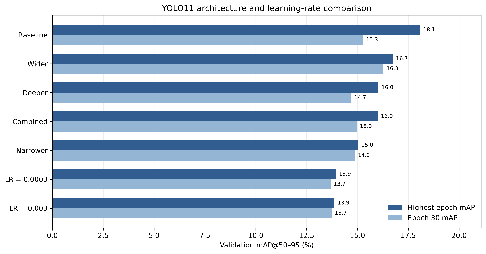
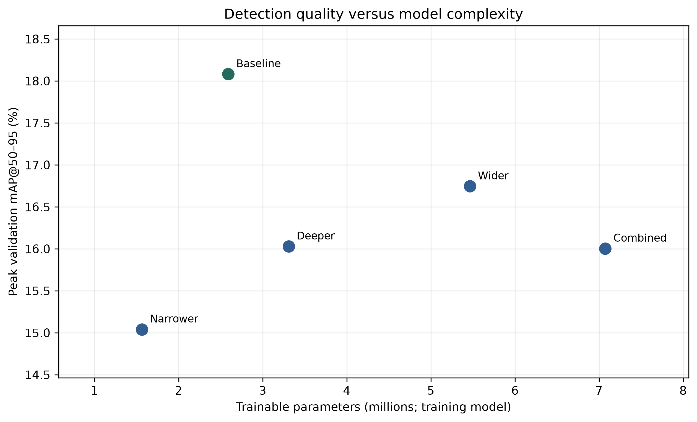
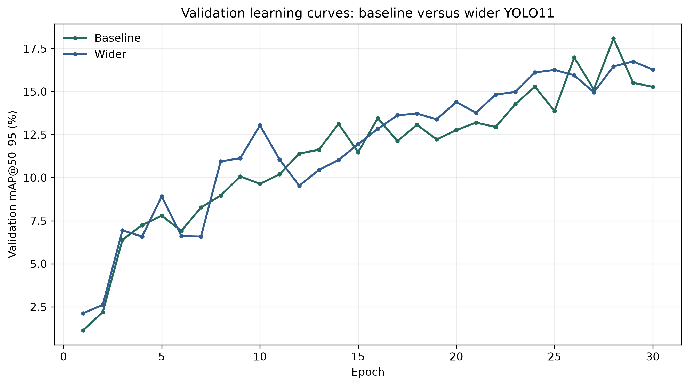
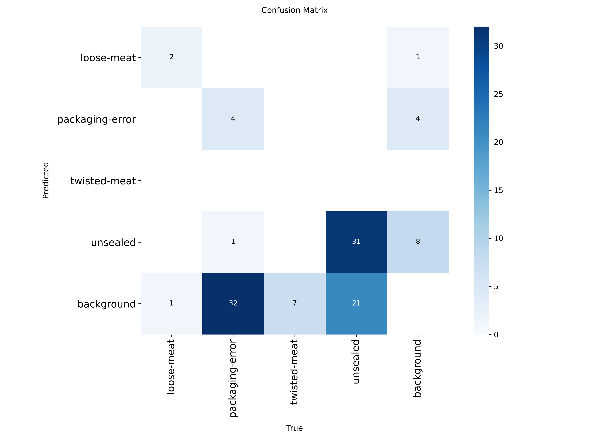

# MMA3001 — Automated Pork Packaging Quality Inspection

**Monash University | MMA3001: Numerical Methods and Machine Learning | 2026**

## 1. Project Overview

This project investigates the use of computer vision and deep learning to identify packaging defects in pork rasher products. The engineering motivation is to support automated quality inspection in food manufacturing, where manual inspection can be time-consuming and subject to inconsistencies.

The proposed solution uses **Ultralytics YOLO11**, an object-detection neural network, to locate and classify four visible defect categories:

- `loose-meat`
- `packaging-error`
- `twisted-meat`
- `unsealed`

Given an RGB image of packaged pork, the model produces bounding boxes, predicted defect classes and confidence scores.

The project investigates whether changes to neural-network architecture and learning rate can improve detection performance while maintaining reasonable computational efficiency.

**Scope:** The implemented system performs defect detection, not a fully validated package-level Pass/Fail classification. Its outputs could inform a future inspection decision system, but the current model is not suitable for unsupervised industrial deployment.

## 2. Objectives

The main objectives are to:

1. Develop a reproducible YOLO11 training and evaluation workflow.
2. Compare different model depths, widths and learning rates.
3. Evaluate detection performance using precision, recall and mean Average Precision (mAP).
4. Investigate computational cost and model complexity.
5. Select a model using validation data and evaluate it on a separate test dataset.
6. Identify limitations and recommend improvements for practical quality inspection.

## 3. Dataset

The project uses the **[Pork Rasher Error Packaging Dataset — Version 1](https://universe.roboflow.com/hello-2aqe0/pork-rasher-error-packaging/dataset/1)** from Roboflow Universe.

The dataset contains labelled images in YOLO object-detection format. Each annotation identifies a defect class and its bounding-box coordinates.

| Dataset split | Images | Purpose |
|---|---:|---|
| Training | 1,944 | Train model weights |
| Validation | 120 | Compare configurations and select the final model |
| Test | 80 | Evaluate the selected model on held-out data |

The validation split contains 155 annotated defect instances, while the test split contains 99 instances.

All seven controlled experiments use **Dataset V1** to maintain consistent comparisons. Other dataset versions were not evaluated.

### Dataset setup

Raw dataset images are not included in this GitHub repository.

To reproduce the experiments:

1. Open the [Roboflow Dataset V1 page](https://universe.roboflow.com/hello-2aqe0/pork-rasher-error-packaging/dataset/1).
2. Download Version 1 in a YOLO-compatible object-detection format.
3. Extract the dataset into `data/raw/dataset_v1/`.
4. Confirm that `data.yaml` defines the training, validation and test image locations and the four defect classes.

Expected local structure:

```text
data/
└── raw/
    └── dataset_v1/
        ├── data.yaml
        ├── train/
        │   ├── images/
        │   └── labels/
        ├── valid/
        │   ├── images/
        │   └── labels/
        └── test/
            ├── images/
            └── labels/
```

The dataset configuration is expected at:

`data/raw/dataset_v1/data.yaml`

The source dataset is published under **CC BY 4.0**. Its licence is separate from the software licence in this repository.

## 4. Technologies and Environment

The project was developed locally using:

| Component | Implementation |
|---|---|
| Programming language | Python 3.11.9 |
| Object detection | Ultralytics YOLO11 |
| Deep-learning framework | PyTorch |
| Optimiser | AdamW |
| Development environment | Visual Studio Code |
| GPU | NVIDIA GeForce RTX 3050 Laptop GPU |
| Automated testing | pytest |
| Source documentation | pdoc |
| Version control | Git and GitHub |

The dependency versions used in the development environment are recorded in [`requirements.txt`](requirements.txt).

GPU-enabled PyTorch installation may require a compatible CUDA build for the host computer.

## 5. Installation

The following commands use **Windows PowerShell** and assume Python 3.11 is installed.

Clone the repository:

```powershell
git clone https://github.com/JS-GITS/MMA3001_Project.git
cd MMA3001_Project
```

Create a virtual environment:

```powershell
py -3.11 -m venv .venv
```

Install dependencies:

```powershell
.\.venv\Scripts\python.exe -m pip install -r requirements.txt
```

Check the demonstration environment:

```powershell
.\.venv\Scripts\python.exe main.py check
```

Some checks will report missing files on a fresh clone because the raw dataset and trained model checkpoint are not stored in GitHub.

## 6. Project Structure

```text
MMA3001_Project/
│
├── main.py
├── README.md
├── LICENSE
├── requirements.txt
├── .gitignore
│
├── configs/
│   └── generated/
│       └── YOLO11 architecture YAML configurations
│
├── src/
│   ├── train.py
│   ├── run_architecture_experiments.py
│   ├── plot_report_figures.py
│   └── view_results.py
│
├── tests/
│   └── test_architecture_experiments.py
│
├── docs/
│   ├── html/
│   ├── test_report.txt
│   └── test_report.xml
│
└── results/
    ├── experiments/
    ├── evaluation/
    ├── report_figures/
    └── demo/
```

### Main scripts

| File | Purpose |
|---|---|
| `main.py` | Demonstration entry point for checking files, reviewing results, running inference and executing tests |
| `src/train.py` | Preliminary 10-epoch smoke test using COCO-pretrained YOLO11n weights |
| `src/run_architecture_experiments.py` | Creates custom network configurations, trains experiments and summarises results |
| `src/plot_report_figures.py` | Generates comparison figures from saved experiment histories |
| `src/view_results.py` | Utility for viewing project results |
| `tests/test_architecture_experiments.py` | Automated checks of experiment configuration and result-processing behaviour |

The preliminary pretrained smoke test is separate from the seven final controlled experiments, which were **trained from scratch**.

## 7. Experimental Methodology

Seven YOLO11 configurations were investigated by varying:

- Network depth multiplier
- Network width multiplier
- Initial learning rate

All controlled experiments used the same dataset and the following training settings:

| Parameter | Value |
|---|---|
| Epochs | 30 |
| Input image size | 640 pixels |
| Batch size | 2 |
| Optimiser | AdamW |
| Random seed | 42 |
| Initialisation | Random weights |
| Hardware | RTX 3050 Laptop GPU |

The baseline used a depth multiplier of **0.50**, width multiplier of **0.25**, and learning rate of **0.001**.

### Experiment results

The following table reports the highest observed validation mAP@50–95 during each 30-epoch training run.

| Experiment | Depth | Width | Learning rate | Peak validation mAP@50–95 |
|---|---:|---:|---:|---:|
| **Baseline** | **0.50** | **0.25** | **0.001** | **18.08%** |
| Narrower | 0.50 | 0.1875 | 0.001 | 15.04% |
| Wider | 0.50 | 0.375 | 0.001 | 16.75% |
| Deeper | 1.00 | 0.25 | 0.001 | 16.03% |
| Lower learning rate | 0.50 | 0.25 | 0.0003 | 13.94% |
| Higher learning rate | 0.50 | 0.25 | 0.003 | 13.87% |
| Combined | 1.00 | 0.375 | 0.0003 | 16.00% |

The baseline achieved the highest peak validation mAP@50–95 among the configurations investigated.

Increasing depth or width did not improve peak validation performance under the chosen training conditions. The baseline also required fewer parameters than the wider and deeper models.

The experiment history and comparison data are available in [`results/experiments/`](results/experiments/).

## 8. Results and Visualisations

### 8.1 Architecture and Learning-Rate Comparison

The figure below compares the highest and final-epoch validation mAP@50–95 across all seven experiments.



The baseline achieved the highest peak validation performance, but its final-epoch performance was below its peak. This illustrates why the saved best checkpoint was preferred over relying only on the final training epoch.

### 8.2 Model Complexity



The wider model had approximately 5.46 million trainable parameters, compared with approximately 2.59 million for the baseline.

Despite having more than twice the parameter count, the wider model achieved lower peak validation mAP@50–95. Greater model capacity did not guarantee better results for this dataset and training budget.

### 8.3 Validation Learning Curves



The baseline reached its highest validation mAP@50–95 at epoch 28, while the wider model peaked at epoch 29.

The selected model was the **baseline YOLO11 configuration**, based on its observed validation performance and model complexity.

### 8.4 Final Held-Out Test Evaluation

After model selection, the saved baseline `best.pt` checkpoint was evaluated on the separate Dataset V1 test split.

| Metric | Final test result |
|---|---:|
| Precision | 71.8% |
| Recall | 33.1% |
| mAP@50 | 38.6% |
| mAP@50–95 | 15.9% |
| Test images | 80 |
| Annotated test defects | 99 |

The model achieved relatively higher precision than recall, meaning many annotated defects were still missed.

Class-specific test recall also varied:

| Defect class | Recall |
|---|---:|
| Loose meat | 66.7% |
| Packaging error | 10.8% |
| Twisted meat | 0.0% |
| Unsealed | 54.9% |

The low recall for packaging errors and twisted meat is particularly concerning in a quality-inspection application.

#### Test confusion matrix



The confusion matrix illustrates the missed detections and differences in performance between defect categories.

### 8.5 Computational Performance

The final baseline model had approximately **2.58 million fused parameters**, required approximately **6.4 GFLOPs**, and recorded average inference time of **7.4 milliseconds per image** on the development GPU, excluding preprocessing and postprocessing.

These results indicate relatively low inference cost, but computational speed alone does not establish reliable industrial performance.

## 9. Running the Project

The repository includes a demonstration entry point, `main.py`, for reviewing the completed experiments without retraining the models.

All commands should be run from the project root.

### Check project readiness

```powershell
.\.venv\Scripts\python.exe main.py check
```

Checks the presence of the selected checkpoint, experiment summary, dataset images, tests and documentation directories.

### Display the experiment comparison

```powershell
.\.venv\Scripts\python.exe main.py summary
```

Displays the saved results of the seven configurations, including their depth, width, learning rate, parameter count and peak validation mAP.

This command uses the existing experiment summary and does not retrain any model.

### Run a model prediction

```powershell
.\.venv\Scripts\python.exe main.py demo --conf 0.10 --show
```

This loads the final baseline checkpoint and runs inference on a validation image.

The script reports predicted defect classes and confidence scores, saves an annotated output image in `results/demo/`, and optionally opens the image for viewing.

A specific image can be supplied:

```powershell
.\.venv\Scripts\python.exe main.py demo --image "path/to/image.jpg" --conf 0.10 --show
```

The confidence threshold of `0.10` is useful for displaying lower-confidence predictions in the demonstration. Lowering the threshold can also increase false-positive detections; this threshold has not been established as an optimal industrial operating point.

**Important:** An image with no detected boxes is not necessarily defect-free.

### Model checkpoint requirement

Live inference requires the project-trained checkpoint at:

```text
results/experiments/arch_baseline_scratch_30ep/weights/best.pt
```

Model checkpoints (`*.pt`) are excluded from version control. Therefore, a fresh clone does not contain this file.

The checkpoint must be supplied separately from the original completed experiment or recreated through training before running the live demonstration.

Do not replace it with the original COCO-pretrained `yolo11n.pt`, as that file does not contain the trained pork-packaging detector.

## 10. Reproducing the Experiments

To inspect the generated architectures without training:

```powershell
.\.venv\Scripts\python.exe src/run_architecture_experiments.py preview
```

To regenerate the comparison CSV from saved experiment results:

```powershell
.\.venv\Scripts\python.exe src/run_architecture_experiments.py summary
```

To regenerate the report figures:

```powershell
.\.venv\Scripts\python.exe src/plot_report_figures.py
```

To train a new baseline from random initialisation, the experiment runner supports:

```powershell
.\.venv\Scripts\python.exe src/run_architecture_experiments.py baseline --init scratch --epochs 30
```

**Training note:** The experiment runner deliberately refuses to overwrite an existing run directory. Since this repository includes archived results for the original baseline experiment, reproducing a run with the same name requires first preserving and moving the existing run directory out of the training output location.

Training also requires the raw Roboflow dataset and appropriate local hardware. The original seven experiments were performed on one GPU with one random seed.

## 11. Automated Testing

The repository includes automated pytest tests covering:

1. Completeness of the seven experiment configurations.
2. Controlled changes to architecture and learning rate.
3. Reading the number of classes from dataset YAML.
4. Handling a missing dataset configuration.
5. Rejecting invalid dataset class counts.
6. Generating architecture YAML and preventing accidental overwriting.
7. Separating peak validation mAP from final-epoch mAP in result summaries.

### Run the tests

```powershell
.\.venv\Scripts\python.exe main.py tests
```

Alternatively:

```powershell
.\.venv\Scripts\python.exe -m pytest tests -v
```

The committed test report records:

**7 tests passed, 0 failures.**

Test evidence:

- [Readable pytest report](docs/test_report.txt)
- [JUnit XML report](docs/test_report.xml)
- [Test source code](tests/test_architecture_experiments.py)

These tests verify the configuration and results-processing code. They do not replace the validation and test evaluation of the trained neural network.

## 12. Source-Code Documentation

Generated HTML documentation is included in [`docs/html/`](docs/html/).

After cloning the repository, open:

```text
docs/html/index.html
```

in a web browser.

Documentation pages cover the demonstration and source scripts, including their functions and docstrings.

The HTML documentation was generated using pdoc.

## 13. Limitations and Future Work

The investigation has several limitations:

- The selected model achieved only 33.1% overall test recall, so many annotated defects were missed.
- Performance was particularly weak for packaging-error and twisted-meat defects.
- All experiments used Dataset V1; generalisation to other datasets and real production environments is unverified.
- Each configuration was trained using one random seed and 30 epochs.
- The test set contained limited examples for some defect classes.
- The evaluation assessed object detections rather than complete package-level Pass/Fail decisions.

Potential improvements include using pretrained weights for the controlled experiments, collecting more balanced and representative training images, extending the training budget, repeating experiments with multiple random seeds, and selecting confidence thresholds using validation data.

A future inspection system would also require an explicit Pass/Fail decision rule and evaluation on sufficient numbers of both defective and defect-free packages.

## 14. AI Assistance and Academic Integrity

OpenAI ChatGPT was used to assist with experiment planning, initial Python script development, troubleshooting, interpretation of model results, and drafting project documentation.

AI assistance made a substantial contribution to the development and reporting workflow. Generated suggestions were checked through code execution, inspection of experimental settings, automated tests, validation metrics and held-out test evaluation.

The student remained responsible for reviewing the code, executing experiments, verifying numerical results and selecting the final model.

The written MMA3001 project report contains a more detailed **AI Use and Critical Reflection** section, including examples of suggestions that required correction.

## 15. References and Acknowledgements

- [Ultralytics YOLO11](https://docs.ultralytics.com/models/yolo11/)
- [Ultralytics GitHub repository](https://github.com/ultralytics/ultralytics)
- [Roboflow Pork Rasher Error Packaging Dataset V1](https://universe.roboflow.com/hello-2aqe0/pork-rasher-error-packaging/dataset/1)
- [PyTorch](https://pytorch.org/)
- [pytest](https://docs.pytest.org/)
- [pdoc](https://pdoc.dev/)

## 16. Licence

The project source code is released under the [MIT License](LICENSE).

The external Roboflow dataset is subject to its own CC BY 4.0 licence, and third-party software and pretrained model weights remain subject to their respective licences.

---

**MMA3001 — Numerical Methods and Machine Learning, 2026**

This repository presents an experimental object-detection solution and its evaluation evidence. It is an academic prototype, not a certified industrial inspection system.